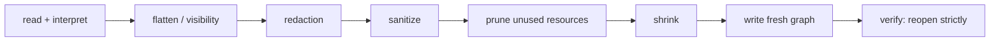

# Foliark: agent instructions

Canonical for Claude Code and Codex (`CLAUDE.md` only imports this file). Read it fully before touching code. The lead agent assigns tasks; execute only the task(s) you were given.

## 1. What Foliark is

Headless Rust/WASM PDF SDK for redacting, editing and sanitizing PDFs in the browser, offline and on mobile, with typed refusals instead of silent fallbacks. First consumer: HDDN (the owner's private app, a separate repo), replacing Pyodide + PyMuPDF.

Status: `@zilijonas/foliark` 0.1.6 on npm (release record `docs/release/candidate.md`), HDDN production on 0.1.6 since 2026-10-25 (first Foliark release in production 2026-10-23) (`docs/integration/hddn-acceptance.md`). License: AGPL-3.0-only plus separate commercial licensing (`LICENSING.md`, `COMMERCIAL-LICENSING.md`). External code contributions are not accepted (`CONTRIBUTING.md`); only the owner and agents acting for the owner commit. Security reports: `SECURITY.md`. Board: Workbench project `NEW` (section 8).

## 2. Architecture

| Path | Role |
|---|---|
| `crates/foliark-model` | ids, geometry, DTOs, error codes, `Limits` (serde + ts-rs; TS types are generated from here) |
| `crates/foliark-engine` | reader, interpreter, render, text/search, edit, redaction, sanitize, writer, export |
| `crates/foliark-text` | font registry, shaping (harfrust/skrifa), paragraph layout |
| `crates/foliark-wasm` | wasm-bindgen facade, bounded stepping, work budget |
| `packages/sdk` | public ESM API: worker client + supervisor (watchdog), inline entry, protocol, generated DTOs (`src/generated`, never hand-edit) |
| `vendor/hayro-syntax`, `vendor/hayro-interpret` | narrow fork of hayro 0.8 via `[patch.crates-io]`, not workspace members. Rules in `patches/hayro/README.md` |
| `tests/` | `fixtures`, `oracles` (independent Python checkers, dev-only), `integration` (acceptance, native_roundtrip, strict_native), `smoke`, `browser`, `package-consumers`, `regressions` |
| `tools/` | `bench` (budgets, export-size), `fuzz-smoke`, `hddn-acceptance`, `release` (dry-run, SBOM); `fuzz/` holds cargo-fuzz targets |

Export pipeline (native, privacy wins: edits, then redactions, then sanitization):

Two passes: the first interprets and decides what survives (flatten, hidden content, redaction targets), the second writes. The writer never copies the input file: it builds a fresh, reachable-only, unencrypted, non-incremental graph from a per-class key allowlist, re-emits every content stream from tokens and passes untouched streams through byte-exact. Output bytes are deterministic. Independent oracles (`tests/oracles`) read the output with parsers unrelated to the engine.

hayro fork: additive, upstreamable changes only; one row per change in `patches/hayro/README.md`, in the same commit as the change. Assign the next free P-id before starting parallel work.

Documents:
- Frozen contract: [docs/spec/v1.md](docs/spec/v1.md) (a change needs an ADR). Dev setup: [docs/development.md](docs/development.md). Support matrix: `docs/support-matrix.md`. Release: [docs/release/process.md](docs/release/process.md), `docs/release/candidate.md`. HDDN integration: `docs/integration/`. Evidence: `docs/evidence/`. Performance and budgets: `docs/performance/`.
- ADRs (`docs/adr/`; newer ones may exist, list the directory):
  - [0001](docs/adr/0001-core-contract.md) core contract and engine stack (hayro fork, own writer, harfrust layout, subsetter)
  - [0002](docs/adr/0002-writer-reemission.md) allowlisted fresh graph; content streams re-emitted from tokens
  - [0003](docs/adr/0003-paragraph-metrics.md) paragraph metrics and how an edit is applied
  - [0004](docs/adr/0004-edit-preview.md) `layoutEdit` preview shares the commit's layout path
  - [0005](docs/adr/0005-strict-font-rebuild.md) strict export rebuilds every retained font
  - [0006](docs/adr/0006-content-hidden-data.md) content streams carry no hidden data (unknown operators, marked-content dicts)
  - [0007](docs/adr/0007-unused-resources.md) export keeps only resources surviving content uses
  - [0010](docs/adr/0010-image-decode-bound-and-no-rotate.md) image streams bounded by their declared size; NoRotate annotations flatten upright
  - [0011](docs/adr/0011-unchanged-text-fits.md) unchanged text fits its edit box (budget measured by the layout); decomposed-cluster fallback
  - [0012](docs/adr/0012-edit-style-segments.md) an edit keeps each style segment (bold heading, regular body) as its own; box measured in the page's fonts
  - [0013](docs/adr/0013-edit-inline-runs.md) an edit keeps inline bold/italic runs: looks carried through a word diff, one layout with per-run fonts, caller font per run's weight/style or `EDIT_NO_FONT`

## 3. Commands

Run from the repo root. `source ~/.cargo/env` if `cargo` is missing. Toolchain pins and prerequisites: `docs/development.md`. Always pass `--locked`.

| Goal | Command |
|---|---|
| Format | `cargo fmt --check` |
| Lint | `cargo clippy --workspace --all-targets --locked -- -D warnings` |
| Rust tests | `cargo test --workspace --locked --no-fail-fast` (one crate: `-p foliark-engine`, `-p foliark-model`, `-p foliark-wasm`) |
| Wasm build + glue | `scripts/build-wasm.sh` (output `packages/sdk/wasm/`, gitignored) |
| Wasm compile check | `cargo build --locked --target wasm32-unknown-unknown -p foliark-wasm` |
| SDK build | `pnpm install && pnpm build:sdk` (needs the wasm glue first) |
| SDK tests | `pnpm --filter @zilijonas/foliark test` (needs wasm build) |
| Rust/TS parity | `scripts/check-ts-parity.sh` (ts-rs output must match `packages/sdk/src/generated`; commit regenerated files) |
| Browser smoke | `pnpm smoke chromium`, `pnpm smoke webkit` |
| Browser specs | `tests/browser/run.sh` (chromium, firefox, webkit: CSP, offline) |
| Package consumers | `tests/package-consumers/pack.sh dist-pkg`, then `tests/package-consumers/run.sh` |
| Oracle self-test | `tests/oracles/.venv/bin/python tests/oracles/controls.py` (venv setup in `tests/oracles/README.md`) |
| strict_native | included in `cargo test --workspace`; checker `tests/integration/strict_native/check.py`, evidence `docs/evidence/strict-native.md` |
| HDDN-corpus acceptance | `SKIP_BUILD=1 tests/integration/acceptance/run.sh` |
| Fuzz smoke | `FUZZ_SECS=30 tools/fuzz-smoke/run.sh` (needs nightly + cargo-fuzz; self-queued, run unwrapped) |
| Budgets | `node --test tools/bench/check-budgets.test.mjs`; fresh `node tools/bench/sdk.mjs --extended` and `node tools/bench/scans-sdk.mjs` output through `node tools/bench/check-budgets.mjs FRESH.json` |
| Export size vs PyMuPDF | `cargo build --release -p foliark-engine --example export_size && tests/oracles/.venv/bin/python tools/bench/export-size.py --check` |
| Notices | `node scripts/gen-notices.mjs --check` (regenerate without `--check`) |
| Release dry run | `tools/release/dry-run.sh` |
| License check | `cargo deny check licenses bans sources` |

Full local check order: fmt, clippy, cargo test, build-wasm, SDK build, parity, SDK tests, smoke. CI (`.github/workflows/ci.yml`) mirrors it on Linux; the full release list is in `docs/release/candidate.md`.

## 4. Hard rules

Privacy (a violation is a critical defect, not a bug):
- No silent fallback, skip, rasterization, empty-on-decode-failure or shrink-to-fit. Every operation completes or fails with a typed `FoliarkError` and no partial output; unsupported means a typed refusal (spec section 0, 12).
- Recoverable content in an export (text, pixels, vectors, metadata, hidden data, stream bytes) is a critical defect. Fix it with a regression fixture plus an oracle assertion.
- Never weaken an oracle expectation, budget or negative control without adding a new positive assertion that covers what it used to cover. Run `controls.py` first: an oracle that has not just caught its leaky controls proves nothing.
- No document content in logs, caches, telemetry or requests.
- No C/C++ PDF engines (PDFium, MuPDF, Poppler, qpdf) in the shipped graph; they may be dev-only oracles under `tests/oracles` (PyMuPDF from `tests/oracles/requirements.txt`).
- Do not change the frozen spec without an ADR. Do not change vendored hayro except additively with a `patches/hayro/README.md` row.

Process:
- Tests prove behaviour that could break. No tests that mirror the implementation, no trivial getter tests. Privacy-relevant behaviour needs an independent oracle and a negative control.
- Ponytail style: smallest complete change, reuse before adding, no speculative abstraction. Keep validation, error handling and security. If a Ponytail skill is installed, load it.
- Licensing: keep SPDX/licence headers and notices. Retain font licences and `THIRD_PARTY_NOTICES.md`/`NOTICE`; regenerate notices with `node scripts/gen-notices.mjs` when dependencies change. Do not add dependencies with incompatible licences (`deny.toml`).
- Update the matching doc whenever a claim moves (`docs/support-matrix.md`, `CHANGELOG.md`, notices).
- Do not modify the HDDN checkout unless the task is an HDDN integration task; then work only in the worktree you were given.
- Do not spawn other agent tools or delegate your task unless the lead or task says to.

Git, push, publish:
- Commit on the branch you were given. Conventional commits, `type(scope): summary (TASK-ID)`, one logical change per commit, body says why, ending with a `Co-Authored-By:` trailer naming your actual model (for example `Co-Authored-By: Claude Sonnet 5.5 <noreply@anthropic.com>`).
- Stage only your own files (other agents commit concurrently). `git pull --ff-only` before pushing.
- Never push per commit or per task (each push costs GitHub Actions minutes). Commit locally; the lead pushes one batch branch, opens one PR, and merges it when the wave is done. Push only when the lead or owner asks, as normal fast-forward pushes. Never force-push, change repository visibility, add remotes, create tags or releases, or publish packages (npm, crates) unless the task explicitly authorizes that exact action. Login/2FA stays with the owner.

Local machine (owner's Mac mini, only where `~/ai/bin/memory-queue` exists; plain runs elsewhere):
- Every `cargo build/test/clippy`, `wasm-bindgen`, browser and Playwright run goes through the queue:
  `~/ai/bin/memory-queue run --owner <your session id> --label 'foliark <what>' --need-gb 4 --restartable --wait 1800 -- <cmd>`
  Use `--need-gb 2` for browser-only runs. Exit 75 means deferred: wait and retry, not a failure. Run long jobs in the background and do not poll. `cargo fmt --check` and file edits need no reservation.
- Never nest reservations: scripts that queue themselves (`tools/fuzz-smoke/run.sh`) run unwrapped.

Receipts: attach one Markdown receipt per task (at most about 1500 chars): commit hash, files touched, exact commands with exit codes, case counts, limitations, next step. Check every Done-when line explicitly; never claim a check you did not run. If blocked, say exactly what is missing.

## 5. Practices learned here

- Run the independent oracles, not only unit tests: the engine must never grade itself. A new export defect class needs an oracle check and a negative control that proves the oracle catches it.
- Assign hayro patch ids (next free P-number) before parallel work so concurrent branches do not collide.
- Parallel agents work in worktrees under `.worktrees/` (gitignored), one branch each; never edit another agent's worktree.
- Determinism is a contract: same input, ChangeSet, policy, fonts and SDK version give identical bytes. Pack twice and compare sha256 when touching the writer or packaging.
- The budgets gate (`tools/bench/budgets.json`) fails on regressions; do not raise a budget to make a change pass without a recorded reason.
- ts-rs DTOs regenerate during `cargo test`; commit them and run the parity check.
- Re-cutting a release candidate: follow `docs/release/process.md` and record bytes and sha256 in `docs/release/candidate.md`; the version in `packages/sdk/package.json`, the `CHANGELOG.md` heading and the workflow input must agree. Do not publish from an agent unless authorized (section 4).
- Waiting on a long command: run it in the background and wait for its completion notification. Never poll with `pgrep -f "<pattern>"` loops: the pattern matches the watcher's own command line, so the loop never ends.

## 6. Optional local tooling

- graphify (owner-machine skill): `/graphify .` builds a code knowledge graph in `graphify-out/` (gitignored, regenerate on demand; do not commit). Useful for cross-crate orientation, not required; the module map in section 2 and `docs/spec/v1.md` section 14 are authoritative.
- lean-ctx: owner-machine context tool; use it only if available. Nothing in this repo depends on it.
- Workbench MCP: see section 8; required for task work.

## 7. Skills

No third-party project skills are installed: the candidates checked on skills.sh (Rust, wasm, PDF, TypeScript library, Playwright, security review, release) were generic, tool-specific to other stacks or heavy relative to this repo, and are covered by the rules above. Record any future addition (source, commit, licence) here. Owner-installed global skills (Ponytail, code review, security review, superpowers and similar) apply on the owner's machine; do not rely on them being present.

## 8. Workbench (task board)

This repo is linked to a Workbench project through `.workbench.json` (`{ "project": "NEW" }`). **The board is the source of truth for what to work on.**

Use the `workbench` MCP server and pass your working directory as `cwd`, or the project key as `project`, on every call.
**This repo's project is only the default.** When the user names a project or product area ("in Outrouted business", "in the
ops project"), call `list_projects` first and pass the matching `project` NEW; a name match beats this repo's default.

- **Claude Code** can fall back to the `workbench` CLI.
- **Codex** uses MCP only: its sandbox has no network for the CLI.
- Edit the Markdown mirror (`~/.workbench/export/NEW/ID.md`) only as a last resort.

### Loop

1. `next_task` returns the highest-priority task you may run alone. Resume anything already `doing` first. If nothing is runnable, say so and list what waits on the user.
2. Call `get_task {id, full: true}` and `get_prompt {id}`. Read every prerequisite's artifacts. A `{{X_OUTPUT}}` token means that task's output.
3. Call `set_status {id, status: "doing"}`. This is a claim: if it returns 409, someone else took the task, so call `next_task` again. Keep one task in progress unless told otherwise.
4. Do the work. Follow the task's requirements and mode (`/plan` is read-only, `/goal` implements). Do not:
   - deploy or write to production
   - make payments or bookings
   - use credentials
   - make uncontrolled paid API calls
   - refactor unrelated code
5. Call `attach_artifact` with the durable output: an audit, spec or decision as Markdown, or a PR link. Record evidence: files changed, commands run, numbers. For this repo pass the receipt inline (`content`), never `sourcePath` (overrides the default of copying repo files by `sourcePath`).
6. Check every clause of **Done when** against that evidence and write the check into the artifact.
7. Call `set_status {id, status: "review"}`. A lead agent (you, when the user put you in charge) approves Review work with `set_status {status: "done", note: "<verdict>"}` or sends it back with `todo` and a note. A 403 `owner_approval` means the user approves that one: leave it in Review and move on. Never wait on approvals.
8. If your findings change a later task, `update_task` it and `add_note` saying what changed and why.

### Stop and ask

Call `set_status {id, status: "blocked", reason}` with a specific reason, and tell the user, when you need any of these:

- a manual action
- credentials
- sign-off on spending, production or an irreversible step
- spending
- a production action
- an ambiguous product or business decision

Never run tasks assigned to ME, ChatGPT or Claude Design. Never skip a blocked task silently or invent a missing decision.

### Before you stop

Don't leave a task in `doing`. Hand it back as `todo` with a note, or set `blocked` with a reason. Findings that change a later task go in `update_task` plus `add_note`.
