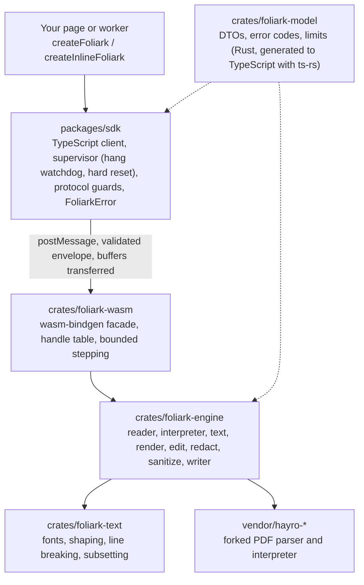

<p align="center">
  <picture>
    <source media="(prefers-color-scheme: dark)" srcset="logo-dark.svg">
    
  </picture>
</p>

<p align="center"><b>A headless PDF engine in Rust and WebAssembly. Extract, search, render, edit, redact and sanitize PDFs in the browser. The document never leaves the device.</b></p>

> **Status:** unreleased 0.1.0 candidate. The owner selected AGPL-3.0-only plus separate commercial licensing on 2026-10-22; see [License](#license). Public npm release and the account-scoped package-name migration are tracked in NEW-90/NEW-91. The recorded rc2 tarball predates this license change and must be rebuilt before publication.

Foliark is a TypeScript SDK (`@foliark/sdk`) over a Rust engine compiled to WebAssembly. It runs in a worker, fetches only its own
`.wasm` and worker script, and refuses what it cannot do safely with a typed `FoliarkError` instead of degrading quietly.
Its first consumer is HDDN, a private PDF redaction app that used PyMuPDF inside Pyodide.

## Why

Replacing PyMuPDF in Pyodide with one small engine and a stricter export. Numbers are medians in Chromium 151 on an Apple M4, same input files for both
engines, from [docs/performance/comparison.md](docs/performance/comparison.md) (WebKit 26.5 shows the same pattern):

| | HDDN on PyMuPDF + Pyodide | Foliark SDK |
|---|---|---|
| Cold start, bytes downloaded | 1,596 ms, 30.4 MB | 19 ms, 5.4 MB (2.05 MB with gzip) |
| Open + extract + render every page (30 pages) | 1,001 ms | 223 ms |
| Native export with 10 redaction regions (30 pages) | 399 ms | 249 ms |
| Image-only export at 2x (30 pages) | 4,132 ms | 1,029 ms |
| Wasm linear memory after all operations | 249.7 MB | 74.8 MB |
| Native export size (keyword redaction, 30 pages) | 28,747 B | 27,500 B |

How to read them:
- Not like-for-like everywhere: HDDN's render time includes PNG encoding, the SDK returns raw RGBA, and the two raster exports use different rasterizers.
- One exception where Foliark is **not** faster: first render of a progressive-JPEG RGB scan at scale 1.35 (82.5 ms against 76 ms). JPEG entropy decoding dominates and has no scaled decode upstream.
  Every other scan type tested is 1.3x to 21x faster, and a repeat render of a page takes 1 to 2 ms.
- Privacy: native export is a rebuilt, allowlisted file (no incremental updates, metadata, attachments, scripts or orphan objects), checked by independent oracles.
  HDDN on Foliark passes 25 of 25 browser end-to-end cases in Chromium, Firefox and WebKit, with zero requests to the retired engine
  ([docs/integration/hddn-acceptance.md](docs/integration/hddn-acceptance.md)).
- All of this is synthetic fixtures on one machine. Phones are not measured.

## Features

| Supported | Refused with a typed code (not a silent fallback) | Not established |
|---|---|---|
| Open, including RC4 and AES encrypted input (output is never encrypted) | Repaired or truncated files (`REPAIRED_PDF`, unless `allowRepaired`) | Real iPhone, iPad, Android and Safari |
| Text extraction, search, hit test, selection | Limits exceeded: 64 MiB, 1000 pages, 50 Mpx (`LIMIT_EXCEEDED`) | Legacy CJK CMaps (`CMAP_MISSING`, no pack ships) |
| Page render to RGBA, with warnings | Text or images inside tiling-pattern cells (`REDACT_PATTERN_UNSUPPORTED`) | JPX, JBIG2 and CCITT payload redaction |
| Paragraph edit (horizontal, unrotated, left-to-right text) | Soft-mask groups under a redaction, XFA, unevaluable optional content | Real-world document sets beyond the 80 test files |
| Redaction of text, images, vectors and forms | Forms without an appearance (`FORM_APPEARANCE_MISSING`) | Retained CFF and Type1 glyph inventories (disclosed in the report) |
| Native export: sanitized rewrite, with a report of what was removed | Signed input when the policy says `refuse` (`SIGNED_INPUT`) | |
| Image-only export with redactions burned in (needs consent) | Image-only export when a page cannot render completely (`RENDER_INCOMPLETE`) | |
| Cancellation (`AbortSignal`), worker hang recovery | | |

The full matrix, each row with its evidence, is [docs/support-matrix.md](docs/support-matrix.md).

## Quick start

Nothing is on npm. Build the tarball and install it into your project ([docs/deployment.md](docs/deployment.md) covers hosting, CSP and offline use):

```sh
scripts/build-wasm.sh && pnpm build:sdk && tests/package-consumers/pack.sh dist-pkg
npm install ./dist-pkg/foliark-sdk-0.1.0.tgz
```

Start the engine in its own worker (both URLs are explicit, nothing is fetched until you call it):

```ts
import { createFoliark } from "@foliark/sdk";
import wasmUrl from "@foliark/sdk/wasm?url";                 // Vite; any bundler that yields the final URLs works
import workerUrl from "@foliark/sdk/worker?worker&url";

const foliark = await createFoliark({ wasmUrl, workerUrl, limits: { maxPages: 200 } });
const doc = await foliark.open(await file.arrayBuffer());   // the buffer is transferred
const page = await doc.extractText(0);                      // text, words with boxes, styles
const hits = await doc.search("invoice");
const png = await doc.renderPage(0, { scale: 1.5 });        // RGBA pixels, ImageData-compatible

// Redact every hit, then export a sanitized native PDF
await doc.applyChanges({
  baseRevision: doc.revision,
  redactions: hits.map((h, i) => ({ kind: "text", id: `r${i}`, pageIndex: h.pageIndex, start: h.start, end: h.end })),
});
const plan = await doc.prepareExport({ mode: "native" });   // plan.report lists what was removed or flattened
const pdf = await doc.export(plan);                         // Uint8Array, single use
```

If your app already runs its own dedicated worker, use the in-worker entry. Same API and errors, no second worker:

```ts
import { createInlineFoliark } from "@foliark/sdk/inline";
const foliark = await createInlineFoliark({ wasmUrl });     // or { wasm: bytesOrModule } to fetch nothing
```

Every failure is a `FoliarkError` with a `code` from the frozen list in [docs/spec/v1.md](docs/spec/v1.md). Editing, image-only export, error handling and limits
are shown in [packages/sdk/README.md](packages/sdk/README.md). A runnable page is in [examples/vanilla](examples/vanilla).

## Architecture



The contract is [docs/spec/v1.md](docs/spec/v1.md). It is frozen: changes need an ADR in [docs/adr](docs/adr). Every operation completes or rejects with a typed error, and capability is never inferred from a preview.
No C or C++ PDF engine is in the shipped graph.

## Repository layout

| Path | Contents |
|---|---|
| `crates/foliark-model` | Shared DTOs, error codes, limits, geometry. Source of the generated TypeScript types |
| `crates/foliark-engine` | The engine: reader, interpreter, text and search, render, edits, redaction, sanitizer, writer |
| `crates/foliark-text` | Font registry, paragraph shaping and layout |
| `crates/foliark-wasm` | wasm-bindgen facade |
| `vendor/hayro-syntax`, `vendor/hayro-interpret` | Forked parser and interpreter, additive patches listed in [patches/hayro](patches/hayro/README.md) |
| `packages/sdk` | `@foliark/sdk`: worker protocol, supervisor, public ESM API, vitest specs |
| `tests/` | Fixtures, independent Python oracles, acceptance matrix, browser specs, smoke, package consumers |
| `fuzz/`, `tools/` | cargo-fuzz targets; benchmarks, budgets, fuzz smoke, HDDN acceptance and release tooling |
| `examples/vanilla` | Plain HTML and JS demo of the public API |
| `docs/` | Spec, ADRs, evidence, performance, release and integration records |

## Development

Needs Rust 1.99.1 (pinned by `rust-toolchain.toml`, installs itself with rustup), `wasm-bindgen-cli` 0.2.129 exactly, Node 26, pnpm 11. Details, browser setup and every other command: [docs/development.md](docs/development.md).

```sh
cargo fmt --check
cargo clippy --workspace --all-targets --locked -- -D warnings
cargo test --workspace --locked          # needs tests/oracles/.venv, see tests/oracles/README.md
scripts/build-wasm.sh && pnpm build:sdk  # wasm glue into packages/sdk/wasm, then the SDK
pnpm --filter @foliark/sdk test && pnpm smoke chromium
```

CI runs the same on Linux for every push and pull request. `CLAUDE.md` and `AGENTS.md` are rules for local AI coding agents.

## Testing and verification

The engine never grades itself. Redaction and sanitization are judged by oracles that do not import Foliark (PyMuPDF, pypdf, pikepdf and byte-level scans, with negative controls that must be caught),
over 80 test documents in six scenarios, plus HDDN parity against PyMuPDF on 21 fixtures. Wasm size and timings are held by frozen regression budgets
([tools/bench](tools/bench), [budgets.json](tools/bench/budgets.json)), the parsers by cargo-fuzz targets, and hangs by a worker watchdog. This is evidence, not a privacy certificate for arbitrary files.
See [docs/evidence](docs/evidence), [tests/oracles](tests/oracles/README.md) and [docs/integration/hddn-acceptance.md](docs/integration/hddn-acceptance.md).

## Documentation

| Document | What it is |
|---|---|
| [docs/spec/v1.md](docs/spec/v1.md), [docs/adr](docs/adr) | Frozen contract and the decisions behind it |
| [packages/sdk/README.md](packages/sdk/README.md) | SDK usage by example |
| [docs/support-matrix.md](docs/support-matrix.md) | What is supported, refused or not established, with budgets |
| [docs/deployment.md](docs/deployment.md) | Hosting, CSP, bundlers, offline |
| [docs/development.md](docs/development.md) | Build, test and verification commands |
| [docs/performance](docs/performance/README.md) | Benchmarks and the HDDN comparison |
| [docs/evidence](docs/evidence) | Native round trip, strict native and security acceptance records |
| [docs/integration](docs/integration/hddn-adapter.md) | HDDN adapter and replacement acceptance |
| [docs/release](docs/release/candidate.md), [process](docs/release/process.md) | Release candidate record and checklist |
| [docs/provenance](docs/provenance/assets.md) | Dependency, font and asset provenance |
| [docs/business/licensing-options.md](docs/business/licensing-options.md) | License and contribution options for the owner |
| [docs/research](docs/research), [docs/plan](docs/plan/roadmap.md) | Early spikes, roadmap and contracts |
| [CHANGELOG.md](CHANGELOG.md), [CONTRIBUTING.md](CONTRIBUTING.md) | Changes and how work is done |

## Security

A redaction that leaves content in the exported file is a privacy defect. The owner selected GitHub private vulnerability reporting; publication must enable and verify it. Do not post details publicly; see [SECURITY.md](SECURITY.md).

## License

Copyright (c) 2026 Linas Jonas Zilinskas. Public Foliark code uses [AGPL-3.0-only](LICENSE), with [separate commercial licensing and no-fee HDDN permission](COMMERCIAL-LICENSING.md). See [LICENSING.md](LICENSING.md) for scope and source availability. External code contributions are closed initially. Third-party material retains its own terms and notices ([THIRD_PARTY_NOTICES.md](packages/sdk/THIRD_PARTY_NOTICES.md)).
